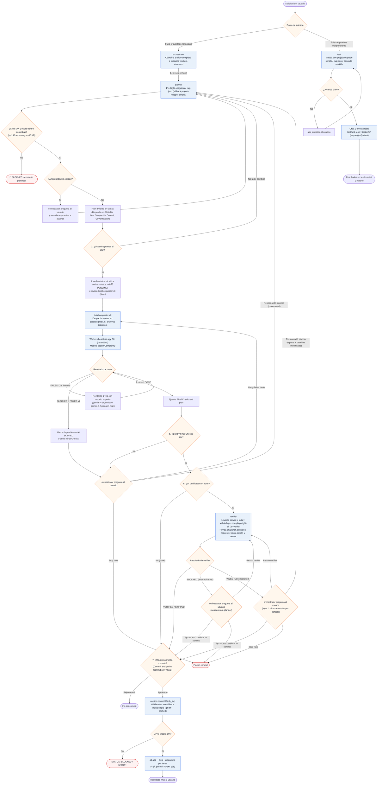

# Flujo actual de agentes

Diagrama construido a partir de los archivos actuales en
`general/gemini/.gemini/config/agents/`.

## Lectura fiel del flujo

- **`orchestrator`** es el único coordinador principal (`mainAgent: true`, `subagent: false`): no inspecciona código, no escribe planes ni edita archivos del proyecto (solo inicializa `<artifact-dir>/workers-status.md`). Coordina a `planner`, `build-orquestor-cli`, `verifier` y `version-control`, y vigila demoras sin respuesta mediante un watchdog (`schedule` de `300s`/`780s` + `manage_subagents`).
- **`planner`** exige pre-flight con `rag-json` (o `project-mapper-simple` como fallback solo si `rag-json` no está disponible y el mapa tiene `<= 150` archivos y `<= 40 KB`); si no, aborta con `🚫 BLOCKED`. Divide el plan en tareas con `Writable files` disjuntos, `Depends on`, `Complexity`, `Commit` y `UI Verification`. Ante fallos de build o de `verifier`, hace **re-planificación incremental** sobre los archivos ya modificados.
- **`build-orquestor-cli`** (`model: flash`) nunca edita código directamente: lanza hasta 5 workers `agy` CLI en paralelo (`--sandbox`, `--output-format json`) para tareas independientes, vigila progreso re-armando `schedule` (`600s`) + `manage_task` mientras queden workers corriendo, reintenta una vez en `FAILED` con un modelo superior y solo ejecuta `Final Checks` si todas las tareas terminan `✅ DONE`.
- **`verifier`** valida flujos web/UI en vivo con `playwright-cli` (`playwright-cli.cmd` en PowerShell de Windows, sesión `-s=verify`), revisando `snapshot`, `console` y `requests`, guardando capturas en `<artifact-dir>` y cerrando siempre sesión y servidor al finalizar. Es de solo lectura sobre el código del repositorio y distingue `FAILED` (re-planificable en `planner` con tope de 1 ciclo por defecto) de `BLOCKED` (problema de entorno/servidor que resuelve el usuario).
- **`version-control`** (`control-versiones.md`, `model: flash_lite`) solo actúa tras aprobación explícita del usuario y recibe un manifiesto `COMMITS` + `PUSH`. Bloquea si detecta archivos sensibles o cambios ya en staging (`git diff --cached --name-only`).
- **`test`** es un agente independiente (no forma parte del pipeline de `orchestrator`) especializado en diseñar, configurar y ejecutar suites permanentes en `test/unit-test/`, `test/e2e/` (`playwright@latest`) y `test/results/`, apoyado en `project-mapper-simple`, `rag-json` y el MCP `ui-skills`.

## Fuentes

- `general/gemini/.gemini/config/agents/orchestrator.md`
- `general/gemini/.gemini/config/agents/planner.md`
- `general/gemini/.gemini/config/agents/build-orquestor-cli.md`
- `general/gemini/.gemini/config/agents/verifier.md`
- `general/gemini/.gemini/config/agents/control-versiones.md`
- `general/gemini/.gemini/config/agents/test.md`
