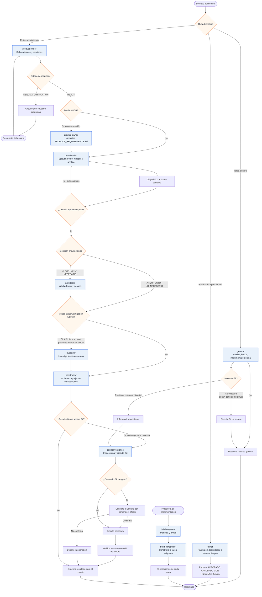

# Flujo actual de agentes

Diagrama construido a partir de los archivos actuales en
`general/opencode/.opencode/agent/`.

## Lectura fiel del flujo

- `orquestador` coordina seis subagentes (`product-owner`, `planificador`,
  `arquitecto`, `buscador`, `constructor` y `control-versiones`) y no ejecuta
  comandos directamente.
- `product-owner` siempre precede a `planificador` en el flujo especializado.
- `planificador` exige `project-mapper` antes del análisis.
- El usuario debe aprobar el plan antes de arquitectura, búsqueda o construcción.
- `arquitecto` solo participa cuando el planificador marca
  `ARQUITECTO: NECESARIO`.
- `buscador` solo participa cuando se necesita información externa.
- `constructor` (`implementador.md`) implementa y verifica, pero no gestiona Git.
- `tester` es un agente primario independiente que valida la implementación en
  la carpeta aislada `.tester/tests/`; no forma parte del flujo del
  `orquestador`.
- `control-versiones` es el agente que puede ejecutar Git. Consulta al usuario
  antes de comandos que cambien índice, historial, ramas, archivos o remotos.
- `general` es un agente primario con una ruta independiente para tareas de
  análisis, implementación, diagnóstico y validación autónomas. Permite Git de
  lectura y bloquea Git de escritura.

## Fuentes

- `general/opencode/.opencode/agent/orquestador.md`
- `general/opencode/.opencode/agent/general.md`
- `general/opencode/.opencode/agent/product-owner.md`
- `general/opencode/.opencode/agent/planificador.md`
- `general/opencode/.opencode/agent/arquitecto.md`
- `general/opencode/.opencode/agent/buscador.md`
- `general/opencode/.opencode/agent/implementador.md`
- `general/opencode/.opencode/agent/build-orquestor.md`
- `general/opencode/.opencode/agent/build-constructor.md`
- `general/opencode/.opencode/agent/tester.md`
- `general/opencode/.opencode/agent/control-versiones.md`
