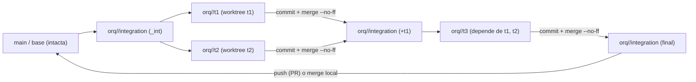
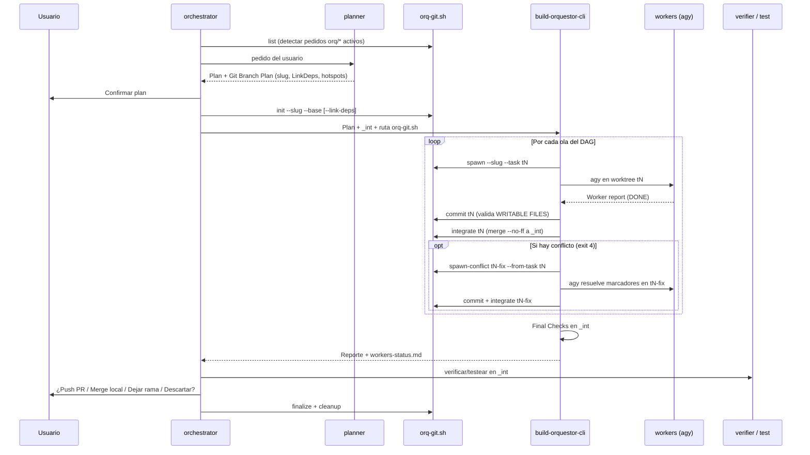

# agents-orchest-git-linux

Flujo completo de agentes para **Linux / macOS (Bash)** con **aislamiento por ramas Git + `git worktree`** y manejo determinista de Git mediante `scripts/orq-git.sh` (Bash puro, sin dependencias externas ni gasto de tokens de LLM en operaciones rutinarias de Git).

## Qué cambia respecto a `agents/`

| Aspecto | `agents/` (original) | `agents-orchest-git-linux/` |
|---|---|---|
| Carpeta de trabajo | Todos los workers comparten la misma carpeta | 1 copia aislada (`git worktree`) por tarea + 1 worktree `_int` para integración |
| Copia principal del usuario | Se modifica directamente durante el build | Queda intacta hasta que aprobás hacer `merge` a tu rama base |
| Paralelismo | Prohibido compartir archivos entre tareas paralelas | Pueden editar distintas zonas del mismo archivo; si chocan las mismas líneas, se detecta en el merge |
| Commits | Manual al final vía agente `control-versiones` (LLM) | Commit atómico por tarea vía `orq-git.sh` (cero tokens extra), con validación estricta de `WRITABLE FILES` |
| Reintento tras fallo | Sobre archivos a medio editar | Limpia worktree/rama (`cleanup --force`) y recrea desde integración limpia |
| Conflictos de merge | No aplica (se evitaban secuenciando) | `integrate` aborta limpio (exit 4) y lanza un worker en worktree `spawn-conflict` (`<tid>-fix`) |
| Verifier y Test | Corren sobre la copia principal | Corren aislados sobre el worktree de integración `_int` |

> **Nota:** `control-versiones.md` se reemplaza intencionalmente por `scripts/orq-git.sh` para ahorrar tokens y garantizar salidas JSON deterministas.

---

## Jerarquía de ramas y carpetas



Ubicación de worktrees por defecto (fuera del repo para evitar ruido en `git status` y mappers):
- Integración del pedido: `${XDG_STATE_HOME:-$HOME/.local/state}/orq-wt/<repo>/<slug>/_int` (configurable con `--wt-root` o variable `ORQ_WT_ROOT`).
- Cada tarea: `${XDG_STATE_HOME:-$HOME/.local/state}/orq-wt/<repo>/<slug>/<task-id>`.
- Tag de checkpoint inicial: `orq/<slug>/base`.

---

## Flujo completo



---

## Archivos de esta carpeta

| Archivo | Rol |
|---|---|
| [orchestrator.md](orchestrator.md) | Coordina `planner`, inicializa/cierra el pedido con `orq-git.sh`, lanza `build-orquestor-cli`, `verifier` y `test` en `_int`, y pide confirmación antes de `push`, `merge` o `cleanup --discard`. |
| [planner.md](planner.md) | Usa `rag.sh`/`python3` y agrega **Git Branch Plan** (`Slug`, `Base branch`, `LinkDeps`, `Conflict hotspots`), además de replanificación incremental leyendo `_int`. |
| [build-orquestor-cli.md](build-orquestor-cli.md) | Orquesta olas DAG en Bash: `spawn`, worker `agy` en worktree aislado, `commit` con chequeo de scope, `integrate` (`--no-ff`), retry limpio y `spawn-conflict`. |
| [verifier.md](verifier.md) | Valida UI con `playwright-cli` levantando el servidor desde `_int`. |
| [test.md](test.md) | Diseña y corre tests unitarios/E2E dentro de `_int` (respetando symlinks compartidos) sin tocar la copia principal. |
| [scripts/orq-git.sh](scripts/orq-git.sh) | Script determinista de Git y worktrees en Bash puro con salida JSON en una línea. |

---

## Referencia rápida de `orq-git.sh`

```bash
bash scripts/orq-git.sh <accion> ...
```

| Acción | Parámetros clave | Qué hace |
|---|---|---|
| `init` | `--slug --base [--link-deps node_modules] [--copy-files .env,...] [--wt-root]` | Crea rama `orq/<slug>/integration`, worktree `_int`, tag `orq/<slug>/base` y enlaza/copia extras. |
| `spawn` | `--slug --task` | Crea rama `orq/<slug>/<task>` y worktree desde `integration`. |
| `spawn-conflict` | `--slug --task <fixId> --from-task <task>` | Crea worktree desde `integration` e inicia `merge --no-commit` de `<from-task>` dejando los conflictos listos para resolver. |
| `commit` | `--slug --task --message --files` | Verifica que todos los cambios estén dentro de `--files` y sin secretos; hace `git add` + `commit`. Soporta commits de merge y `--task integration`. |
| `integrate` | `--slug --task` | Hace `merge --no-ff` de `orq/<slug>/<task>` en `_int`. Si hay conflicto, hace `merge --abort` y sale con código `4`. |
| `status` | `--slug` | Muestra estado de `integration`, tareas, SHAs, commits pendientes y rutas de worktrees. |
| `list` | — | Lista pedidos `orq/*` activos en el repo. |
| `finalize` | `--slug --mode none\|push\|merge` | Muestra log o hace `push -u origin` de `integration` o `merge --no-ff` hacia `--base`. |
| `cleanup` | `--slug (--task \| --all) [--force] [--discard]` | Elimina worktrees y ramas ya mergeadas (`--force` fuerza tarea no mergeada; `--discard` con `--all` descarta incluso `integration` sin mergear). |

### Códigos de salida
- `0`: `OK` / `EMPTY` / `NOOP`
- `2`: `BLOCKED` (precondición o parámetros inválidos; no modifica nada)
- `3`: `SCOPE_VIOLATION` (cambios fuera de `--files` o archivos sensibles; no commitea)
- `4`: `CONFLICT` (conflicto abortado en `integrate`, o marcadores sin resolver en `commit`)
- `5`: `ERROR` (error de Git o remoto)

---

## Cómo activarlo en Linux / macOS

1. **Activación:** copiá el contenido de `agents-orchest-git-linux/` en `~/.gemini/config/agents/` (o en `.agents/` de tu proyecto si querés usarlo por repo):
   ```bash
   cp -r agents-orchest-git-linux/* ~/.gemini/config/agents/
   chmod +x ~/.gemini/config/agents/scripts/orq-git.sh
   ```
2. **Dependencias pesadas (`node_modules` / `.venv`):** usá `LinkDeps` cuando las tareas no agregan ni actualizan paquetes (crea un symlink `ln -s` instantáneo sin duplicar archivos). Si una tarea modifica `package.json`/lockfiles, dejá `LinkDeps: none`.
3. **Archivos `.env`:** `init` y `spawn` copian automáticamente `.env`, `.env.local`, `.env.development`, `.env.development.local`, `.env.test` al worktree y los excluyen del staging para evitar commits accidentales.
4. **Ubicación personalizada de worktrees:** si preferís otra ruta (por ejemplo `/tmp/orq-wt` o `~/worktrees`), exportá `ORQ_WT_ROOT`.
