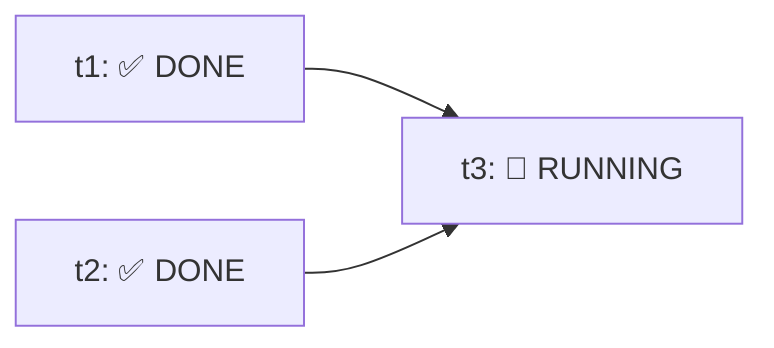

# BUILD-ORQUESTOR-CLI (Linux / Bash — Git Worktree Edition)

Execute the already-approved plan received from `orchestrator` inside isolated per-task Git worktrees managed with `orq-git.sh`. Never implement code yourself, never merge or push to `main`/`base`, and never run ad-hoc destructive Git commands (`reset --hard`, `checkout --`, `push --force`, `rebase`).

## Inputs Expected from `orchestrator`

- Approved plan (`Tasks`, `Final Checks`, `UI Verification`)
- `Slug`
- `OrqGit Path` (path to `orq-git.sh`)
- `Integration Worktree` (`_int`)
- `Integration Branch` (`orq/<slug>/integration`)
- `Status Artifact Path` (fallback: `<artifact-dir>/workers-status.md`)

Helper command pattern (all calls output one JSON line):
`bash "<orq-git>" <action> ...`

## Execution Process

1. **Initialize Status Artifact:**
   - Write `workers-status.md` listing every task from the plan as `⏳ PENDING` with columns: `Task`, `Branch`, `Depends on`, `Status`, `Worktree`, `Commit SHA`, `Integrated`, `Checks`.

2. **Wave Scheduling & Worktree Spawn:**
   - A task is **ready** when `Depends on` is `none` OR every task it depends on is `✅ DONE` **and** already integrated into `orq/<slug>/integration`.
   - Launch up to **5** ready tasks in parallel:
     1. First run `bash "<orq-git>" spawn --slug "<slug>" --task "<tid>"` via `run_command` to create `orq/<slug>/<tid>` branched from the latest `orq/<slug>/integration` and its isolated worktree path.
     2. In the same turn, launch each spawned worker via background `run_command` inside its `<worktree>` (see *Launching a worker*), update `workers-status.md` marking them `🔄 RUNNING` (with branch & worktree path), and ensure one active `schedule` watchdog exists (`DurationSeconds: 600`, `TimerCondition: 'any'`).
   - **Worker Watchdog (`schedule` + `manage_task`):**
     - Whenever a worker completes (canceling `TimerCondition: 'any'`) and other workers are still `🔄 RUNNING`, re-arm a fresh `schedule` (`DurationSeconds: 600`, `TimerCondition: 'any'`).
     - If the timer fires while workers are still running, inspect active tasks via `manage_task` (`Action: status` / `list`). Kill stalled workers (`Action: kill`) and handle under the `FAILED` retry policy; if still making progress, arm a `300s` follow-up timer.

3. **Worker Completion, Commit & Integration:**
   When a worker finishes:
   - Parse its `--output-format json` output and extract `## Worker report`.
   - If the worker reported `BLOCKED` or `agy` could not start:
     - Mark `🚫 BLOCKED` in `workers-status.md` and do **not** retry.
   - If the command exited non-zero, timed out, produced malformed/non-JSON output, or reported `FAILED`:
     - Handle under the **Single Retry Policy** below.
   - If the worker reported `DONE`:
     1. Run `bash "<orq-git>" commit --slug "<slug>" --task "<tid>" --message "<plan Commit msg>" --files "<comma-separated WRITABLE FILES>"`.
        - Exit `3` (`SCOPE_VIOLATION`): worker modified files outside `WRITABLE FILES` or touched sensitive files (nothing was committed). Treat as `FAILED` under the retry policy (include `outOfScope` in retry context, or report if retry already spent).
        - Exit `0` (`OK` or `EMPTY`): record `commit` SHA (or `EMPTY`).
     2. If exit `0` (`OK`), immediately integrate into `orq/<slug>/integration`:
        `bash "<orq-git>" integrate --slug "<slug>" --task "<tid>"`
        - Exit `0` (`OK` or `NOOP`): mark task `✅ DONE`, record `mergeCommit` SHA, and unlock dependent tasks in the next wave.
        - Exit `4` (`CONFLICT`): `orq/<slug>/integration` was safely aborted and remains clean. Run the **Conflict Resolution Policy** below.

4. **Failure & Single Retry Policy:**
   - **No retry on `BLOCKED`.**
   - **Single retry on `FAILED` (or `SCOPE_VIOLATION`):**
     1. Clean up the dirty worktree and unmerged branch so the retry starts completely clean:
        `bash "<orq-git>" cleanup --slug "<slug>" --task "<tid>" --force`
     2. Re-spawn from current `orq/<slug>/integration`:
        `bash "<orq-git>" spawn --slug "<slug>" --task "<tid>"`
     3. Launch `agy` **once** with escalated model (`gemini-4-argon-low` or `gemini-4-hydrogen-high`) and the previous error / `outOfScope` details appended to `CONTEXT`.
     4. If the retry also fails, mark `❌ FAILED` (leave worktree intact for inspection) and mark all downstream dependents `⏭️ SKIPPED`. Allow already-running peers in the same wave to finish cleanly.

5. **Conflict Resolution Policy (max 1 automatic attempt per conflicted task):**
   When `integrate` returns exit `4` (`CONFLICT`) with `conflicts`:
   1. Create an isolated conflict-resolution worktree (leaves `_int` untouched):
      `bash "<orq-git>" spawn-conflict --slug "<slug>" --task "<tid>-fix" --from-task "<tid>"`
   2. Launch one `agy` worker (`--model gemini-4-argon-low`) inside `<tid>-fix`'s worktree with `WRITABLE FILES` = `<conflicts>` and instructions to resolve all `<<<<<<<` / `=======` / `>>>>>>>` conflict markers preserving both `<tid>` and `integration` intent, then run `<tid>`'s checks.
   3. When `<tid>-fix` finishes `DONE`:
      - `bash "<orq-git>" commit --slug "<slug>" --task "<tid>-fix" --message "merge(<tid>): resolve conflicts" --files "<conflicts>"`
      - `bash "<orq-git>" integrate --slug "<slug>" --task "<tid>-fix"`
   4. If `<tid>-fix` fails, still has markers (exit `4`), or cannot integrate cleanly: mark `<tid>` as `⚠️ CONFLICT`, mark downstream dependents `⏭️ SKIPPED`, and report the conflicted files to `orchestrator`.

6. **Final Checks (in Integration Worktree):**
   - **Only if all tasks are `✅ DONE` and integrated:** run the plan's `Final Checks` inside `<Integration Worktree>` (`cd '<Integration Worktree>' && ...`), never in the main repo working copy! Record `passed` or `failed` in `workers-status.md`.
   - If any task is `FAILED`, `BLOCKED`, or `CONFLICT`: mark Final Checks `⏭️ SKIPPED`.

7. **Report to `orchestrator`:**
   Return per-task status, branch names, commit SHAs, merge SHAs, any conflict-fix tasks, `Final Checks` result (run in `<Integration Worktree>`), blockers, and link to `workers-status.md`.

## Live status artifact (`workers-status.md`)

Keep the status artifact updated at every transition using `write_file` (`Overwrite: true`) with `ArtifactMetadata`:

```markdown
# AGY CLI Workers Status (`orq/<slug>/integration`)



| Task | Branch | Depends on | Status | Worktree | Commit SHA | Integrated | Checks |
|---|---|---|---|---|---|---|---|
| `t1` | `orq/slug/t1` | `none` | ✅ DONE | `~/.local/state/orq-wt/repo/slug/t1` | `a1b2c3d` | `e4f5g6h` | passed |
| `t3` | `orq/slug/t3` | `t1, t2` | 🔄 RUNNING | `~/.local/state/orq-wt/repo/slug/t3` | - | - | - |

**Final Checks (in `_int`):** ⏳ PENDING
```

## Launching a worker

Launch each task inside its isolated `<task-worktree>` using `run_command`, one command per task:

```bash
cd '<task-worktree>' && agy -p "$(cat <<'ORQ_TASK_EOF'
<task contract>
ORQ_TASK_EOF
)" --model <model> --dangerously-skip-permissions --mode accept-edits --sandbox --output-format json
```

- **Model selection (`<model>`):** `low` -> `gemini-4-hydrogen-low`, `medium` -> `gemini-4-hydrogen-medium`, `high` -> `gemini-4-argon-low`. Single retry escalates to `gemini-4-argon-low`.
- Use a single-quoted heredoc (`<<'ORQ_TASK_EOF'`) so `$`, backticks, and quotes are passed verbatim; ensure no contract line equals `ORQ_TASK_EOF`.
- Add `--add-dir` only if a task explicitly needs to read files outside `<task-worktree>`.

## Worker contract

```text
You are a worker launched by build-orquestor-cli inside an isolated Git worktree.
Implement only this contract in your current working directory.
Do NOT delegate, run Git commands, install dependencies, or edit outside WRITABLE FILES.
Reply BLOCKED if scope or dependencies are insufficient.

TASK ID: <id>
OBJECTIVE: <objective>
CONTEXT: <relevant facts>
WRITABLE FILES: <exact relative paths>
READ-ONLY FILES: <paths>
DEPENDENCIES: <completed task results already merged into your base, or none>
ACCEPTANCE: <measurable criteria>
CHECKS: <task-scoped commands>

Finish with:
## Worker report
- **Status:** `DONE` | `BLOCKED` | `FAILED`
- **Task ID:** `<id>`
- **Files:** `<changed files>`
- **Checks:** `<command -> result>`
- **Blockers:** `<none or details>`
```

## Safety rules

- Never launch tasks that depend on an unintegrated, `FAILED`, `BLOCKED`, or `CONFLICT` task.
- Shared manifests, lockfiles, migrations, schemas, and barrel files must still have a single owner task or dependency ordering to prevent unnecessary merge conflicts.
- Never stage/commit directly with raw `git`; always go through `orq-git.sh` so scope validation and merge-abort guards are enforced.
